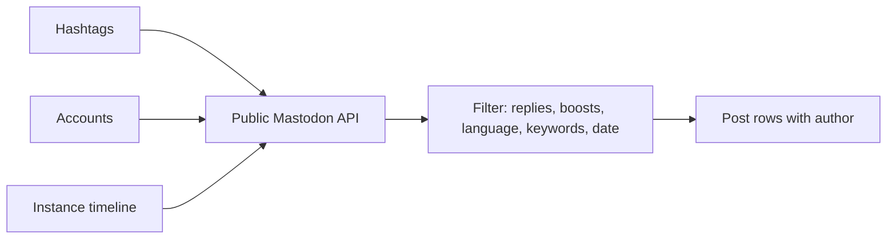

# Mastodon Scraper: Posts by Hashtag, Account or Instance

[](https://apify.com/Turboextract/mastodon-posts-hashtags)
[](LICENSE)
[](#pricing)

**Export Mastodon posts by hashtag, account or instance timeline, with text, date, language, replies, boosts, favourites, hashtags, media, link card and author details.** Works on mastodon.social and any other Mastodon server through the public API. No login.

In one test, the actor returned 45 recent #opensource posts and 45 posts from a well-known account in a few seconds, each with the author's follower count.

**Try it now →** [apify.com/Turboextract/mastodon-posts-hashtags](https://apify.com/Turboextract/mastodon-posts-hashtags)

---

## Why this exists

- Mastodon has no export for hashtags or accounts.
- Full-text search needs a login and only covers some posts.
- Posts are spread across thousands of servers.
- Social listening tools charge monthly and often skip Mastodon.

---

## Who this is for

- **Brands and PR teams** tracking hashtags and mentions on the fediverse
- **Social media managers** finding posts and people to engage with
- **Researchers** studying public conversation on Mastodon
- **Developer relations teams** following tech and open-source hashtags
- **AI and data teams** collecting public social posts

---

## What you get

```json
{
  "id": "117650485816558626",
  "url": "https://example.social/@username/117650485785798925",
  "text": "Has AI Solved Reverse Engineering? ... #linux #opensource",
  "createdAt": "2026-11-20T19:45:45.000Z",
  "language": "en",
  "replies": 0,
  "boosts": 0,
  "favourites": 0,
  "hashtags": ["linux", "opensource"],
  "linkCard": { "url": "https://youtu.be/...", "title": "Has AI Solved Reverse Engineering?" },
  "authorHandle": "username@example.social",
  "authorName": "Author name",
  "authorFollowers": 17,
  "source": "#opensource"
}
```

---

## How it works



---

## Quick start

1. Click **Try for free**.
2. Add **Hashtags**, **Accounts**, or turn on **Instance timeline**.
3. Optional: **Keywords**, **Language** or **Posted within (days)**.
4. Change the **Instance** if you want a server other than mastodon.social.
5. Click **Start**, then export to CSV, JSON or Google Sheets.

### API

```bash
curl -X POST "https://api.apify.com/v2/acts/Turboextract~mastodon-posts-hashtags/run-sync-get-dataset-items?token=YOUR_TOKEN" \
  -H "Content-Type: application/json" \
  -d '{"hashtags": ["opensource", "selfhosted"], "language": "en", "postedWithinDays": 1}'
```

### Python

```python
from apify_client import ApifyClient

client = ApifyClient("YOUR_TOKEN")
run = client.actor("Turboextract/mastodon-posts-hashtags").call(run_input={
    "accounts": ["https://mastodon.social/@username"],
    "maxResultsPerSource": 200,
})
for p in client.dataset(run["defaultDatasetId"]).iterate_items():
    print(p["createdAt"], p["favourites"], p["text"][:80])
```

---

## Input fields

| Field | Default | What it does |
|---|---|---|
| `hashtags` | – | Without the # |
| `accounts` | – | `user@server` or profile URLs |
| `instanceTimeline` | false | Newest local posts on the instance |
| `instance` | mastodon.social | Server for hashtags and timeline |
| `keywords` | – | Match post text |
| `language` | all | Language code, like `en` |
| `excludeReplies` | true | Skip replies |
| `excludeBoosts` | true | Skip reposts |
| `postedWithinDays` | 0 (all) | Only recent posts |
| `maxResultsPerSource` | 100 | Per hashtag or account |
| `maxResults` | 500 | Total cap per run |

---

## Pricing

**$0.003 per post delivered.** 1,000 posts cost $3.

| Option | 1,000 posts |
|---|---|
| **Mastodon Scraper** | **$3**, hashtags, accounts and timelines |
| Other Mastodon actors on Apify | $0.05 to $3 |
| Social listening tools | $50+ a month |

---

## Common use cases

- **Hashtag tracking**: every #yourbrand post, every hour
- **Influencer research**: active accounts with followers in your niche
- **Event coverage**: conference hashtags during the event
- **Content research**: what tech and open-source people share
- **Archiving**: a backup of an account's public posts
- **Language studies**: posts in one language for a hashtag

---

## Tips for best results

- Hashtag timelines show posts the instance knows about. mastodon.social is the largest, so it sees the most.
- Account posts come from the account's own server, so they are complete.
- Dedupe on `url` across scheduled runs.
- For Bluesky, use [Bluesky Scraper](https://apify.com/Turboextract/bluesky-posts-profiles).

---

## Pairs well with

- [Bluesky Scraper](https://apify.com/Turboextract/bluesky-posts-profiles): posts and profiles from Bluesky
- [Lemmy Scraper](https://apify.com/Turboextract/lemmy-posts-comments): fediverse forum posts and comments
- [Telegram Channel Scraper](https://apify.com/Turboextract/telegram-channel-scraper): public channel posts

---

## FAQ

**Do I need a Mastodon account?** No. The actor uses the public API.

**Can it search all posts by keyword?** Mastodon only allows full-text search when signed in, so use hashtags or accounts, then filter with **Keywords**.

**Which servers work?** Any Mastodon server that allows public timelines, which is most of them.

**How fast is it?** About 40 posts per request, a few hundred posts in seconds.

**Is it legal?** It reads public posts through Mastodon's open API.

---

## SEO keywords

Mastodon scraper, Mastodon API, Mastodon hashtag scraper, scrape Mastodon posts, Mastodon account posts export, fediverse scraper, mastodon.social data, social listening Mastodon, Twitter alternative scraper, Mastodon timeline export

---

## Support

- Actor page: https://apify.com/Turboextract/mastodon-posts-hashtags
- Issues and questions: open an issue in this repo
- Community Discord: https://discord.gg/8SrXSCpvgj

Built and maintained by [Turboextract](https://apify.com/Turboextract) on the Apify platform.

---

## License

The documentation and examples in this repository are MIT licensed. The actor itself runs on the Apify platform.
